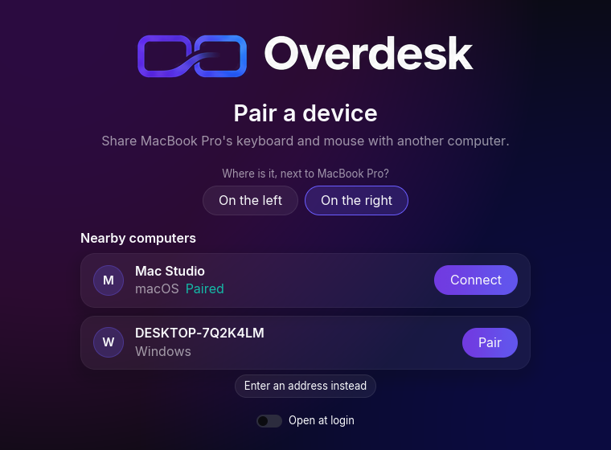
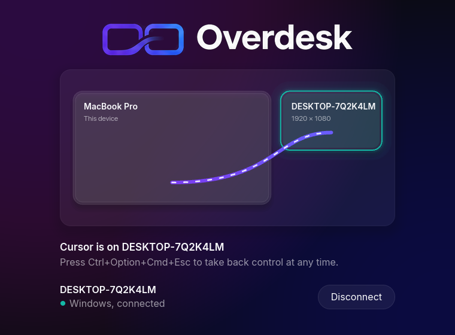
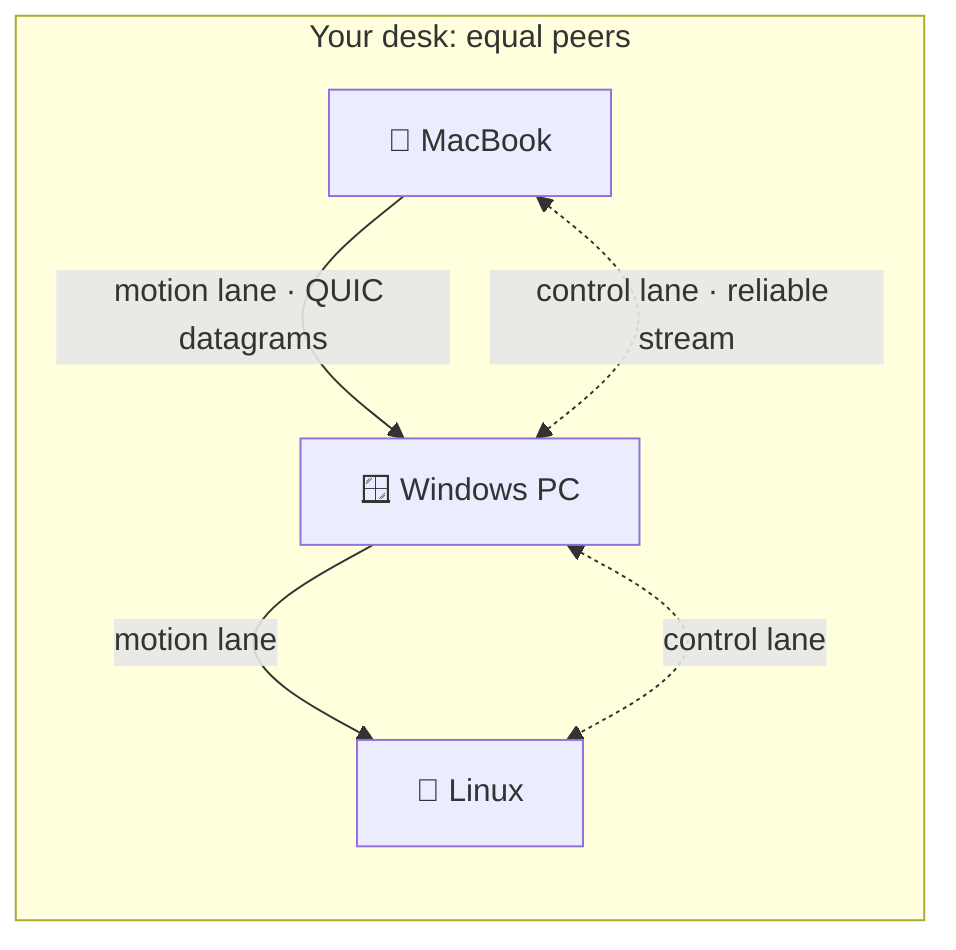
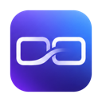

<div align="center">

<a href="https://overdesk.org">
  <picture>
    <source media="(prefers-color-scheme: dark)" srcset="assets/brand/lockup-dark.png">
    
  </picture>
</a>

<h3>One desk. Multiple computers. A single, continuous workspace.</h3>

Share one keyboard and mouse across your Mac, Windows PC, Linux and BSD machines.<br>
Slide the cursor off one screen and keep working on the next, with input that feels native on every one.

<br>

[](https://overdesk.org)
[](rust-toolchain.toml)
[](LICENSE)


[](COMMERCIAL.md)

[**Website**](https://overdesk.org) ·
[**Download**](https://overdesk.org/download) ·
[**Report a bug**](https://overdesk.org/support) ·
[**Architecture**](docs/ARCHITECTURE.md)

<br>

<picture>
  <source media="(prefers-color-scheme: light)" srcset="docs/images/app-idle-light.png">
  
</picture>

</div>

> [!NOTE]
> **Pre-alpha.** Mac to Mac is hand-tested on real hardware: discovery, pairing, crossing
> screens and the native Apple feel. Windows, Linux, FreeBSD, OpenBSD, Pro, Android TV and
> Apple TV are built and tested in software, and the whole codebase has been through a full
> code, performance, security and architecture review. Real-hardware tests follow the
> [hand-test checklist](docs/HAND-TESTS.md). There are no public downloads yet: star or
> watch the repository to follow along.

## ✨ Why Overdesk

Your desk is one workspace, not a server with clients bolted on. Overdesk turns every computer
on it into one continuous desk, and it's written from the ground up in Rust.

<table>
<tr>
<td width="50%" valign="top">

#### ✋ Input follows your hand
No server, no client. Touch the Mac's trackpad and it drives the PC; grab the PC's mouse and
it drives the Mac. Every computer is an equal peer.

</td>
<td width="50%" valign="top">

#### 🍎 Apple input, native everywhere
Pixel-precise Magic Mouse and trackpad scrolling with momentum intact. <kbd>⌘</kbd> <kbd>C</kbd>
copies on Windows and Linux. With Pro, pinch and rotate travel too.

</td>
</tr>
<tr>
<td valign="top">

#### ⚡ A cursor that never stalls
Pointer motion rides QUIC datagrams where the newest wins, so a lost packet is simply
replaced. Keys travel on a separate reliable lane and never arrive out of order.

</td>
<td valign="top">

#### 🔐 Private by default
Every connection is mutual TLS 1.3 with per-device keys kept in the Keychain, DPAPI or the
Linux and BSD Secret Service. Pairing is a 6-digit code shown on both screens. Copies
marked as private by password managers are never shared. No accounts, no cloud.

</td>
</tr>
<tr>
<td valign="top">

#### 🧭 Finds your computers by itself
Nearby computers appear by name, each with its operating system's logo (Apple, Windows, Linux, Android; drawn in the text colour, with the name on hover). Pair once; after a restart, sleep or a dropped Wi-Fi
they find each other and reconnect on their own. Uneven screens line up, even laptops
beside taller monitors, and with Pro you arrange them by dragging on the Desk map. A paired
device that is switched off still appears under **Paired devices**, where you can forget it;
the other computer is told, so it forgets you too.

</td>
<td valign="top">

#### 🔄 Updates itself, no admin rights
The official downloads from [overdesk.org](https://overdesk.org) update themselves, per user, built for managed work laptops.
Builds from source update by rebuilding.

</td>
</tr>
</table>

<div align="center">
  
</div>

## 🗺️ Roadmap

| | What | Status |
|:-:|---|---|
| 0 | Workspace, local checks on every OS, licence checks, CLA | ✅ Done |
| 1 | Two-lane wire protocol and core logic: screen layout, edge switching, held keys, ⌘↔Ctrl | ✅ Done |
| 2 | **macOS** capture and injection with native Magic Mouse, trackpad and keyboard feel | ✅ Hand-tested ([evidence](docs/tdd/macos-adapter.tdd.md)) |
| 3 | QUIC lanes, 6-digit pairing, replicated Desk, latency benchmark | ✅ Tested over loopback |
| 3b | `overdeskd` daemon: Desk engine, saved pairings, failsafe escape chord | ✅ Hand-tested ([evidence](docs/tdd/daemon.tdd.md)) |
| 3c | Discovery over mDNS: nearby computers by name, no IP addresses | ✅ Hand-tested |
| 4 | **Windows**: low-level hooks, Raw Input, `SendInput` | 🧪 Built; real-PC test pending |
| 5 | Desktop app in pure Rust ([iced](https://iced.rs)): Desk map, pairing, tray, light and dark | ✅ Hand-tested on a Mac |
| 6 | **Linux**: X11 (XInput2, XTest) and Wayland via the desktop portals, picked at run time; .deb (Ubuntu, Debian, Mint), .rpm (Fedora, openSUSE, RHEL), pacman and the AUR (Arch, Manjaro), AppImage | 🧪 Built; real-desktop test pending ([Wayland notes](docs/WAYLAND.md)) |
| 6b | **FreeBSD** (X11, and Wayland where the desktop portals exist; `pkg` and a ports Makefile) and **OpenBSD** (X11 only; source build and a ports skeleton). No self-update: pkg and ports update it ([packaging](docs/PACKAGING.md)) | 🧪 Built; FreeBSD cross-linted from a Mac; hand test pending ([BSD tests](docs/HAND-TESTS.md)) |
| 7 | Self-contained per-user installers (nothing else to install: no runtimes, no admin rights), device keys in Keychain / DPAPI / Secret Service; the official downloads from overdesk.org update themselves | 🧪 Built; install-and-update test pending |
| 7b | **Overdesk Pro**: 3+ computers, image and file clipboard, trackpad gestures, **Activate Pro** by signing in on overdesk.org (no key to type) | 🧪 Built; real-hardware test pending |
| 8 | **Android TV** (Pro): pointer, clicks, scrolling and typing on a TV, driven by your computer | 🧪 Built; tested on the Android TV emulator |
| 8b | Screens that don't line up: uneven multi-monitor layouts, drag-to-arrange on the Desk map (Pro), the system's pointer speed and double-click settings, password-manager copies kept private | 🧪 Built; real-hardware test pending |
| 8c | Full code, performance and security review of every crate, with every finding fixed: lower input latency, hardened pairing and transfers, no stuck keys on disconnect | ✅ Done |
| 8d | Architecture pass to a senior standard: typed errors and connection close reasons (a peer's text is never shown), one lock policy, every large file split by job, pairing and trust logic shared with Pro | ✅ Done |
| 9 | **Apple TV** (Pro): a screen on the Desk; push the cursor onto it and your keyboard and mouse are its remote. The open core only carries the generic bits (remote devices in the nearby list, a PIN prompt, `Store::save_secret`) | 🧪 Built; tested against a fake TV, real-TV test pending |
| 9b | VPNs: discovery ignores VPN tunnels and prefers the shared local network, reconnects as soon as the network changes, and a hint when a VPN blocks the local network | 🧪 Built; hand test pending ([VPN tests](docs/HAND-TESTS.md)) |
| 9c | Bug reports a non-technical person can make: an always-on log file, and tray items **Report a bug…** and **Save diagnostics file** that save a text file (versions, OS, displays, paired devices, the newest log lines; never keystrokes, clipboard, PINs, keys or emails) to Downloads and open the support page prefilled | 🧪 Built; hand test pending ([diagnostics tests](docs/HAND-TESTS.md)) |
| 10 | Keep connections on the local network card when a VPN routes the local network into its tunnel (binding the QUIC socket to the physical interface) | ❓ To be decided after the Windows corporate VPN test |

## 🩺 Reporting a bug

Choose **Report a bug…** in the menu-bar or tray menu: Overdesk saves `overdesk-diagnostics-YYYYMMDD-HHMMSS.txt` to your Downloads folder and opens the support page already filled in; attach the file. On the other computer, choose **Save diagnostics file**. The file holds versions, your OS, displays, paired and nearby devices (short id and OS), the connection state and the newest log lines, at most 512 KiB. It never holds keystrokes, pointer positions, clipboard contents, PINs, keys or email addresses.

Overdesk always writes a log, rotated at 1 MiB (one old file is kept):

| OS | Log file |
|---|---|
| macOS | `~/Library/Application Support/Overdesk/logs/overdesk.log` |
| Windows | `%APPDATA%\Overdesk\logs\overdesk.log` |
| Linux, FreeBSD, OpenBSD | `~/.overdesk/logs/overdesk.log` |

`OVERDESK_HOME` moves the folder that holds `logs`.

## 🏗️ Architecture



| Crate | Role |
|---|---|
| [`overdesk-proto`](crates/overdesk-proto) | Wire types for both lanes, length-prefixed control frames (1 MiB cap), wrap-safe motion sequencing |
| [`overdesk-core`](crates/overdesk-core) | Pure logic: layout, cursor focus across screen edges, held-key release, ⌘↔Ctrl remap |
| [`overdesk-net`](crates/overdesk-net) | QUIC transport: mutual TLS 1.3 with device certificates, commit-reveal pairing, mDNS discovery |
| [`overdeskd`](crates/overdeskd) | The daemon and controller: capture, network and injection wired to the Desk engine |
| [`overdesk-platform`](crates/overdesk-platform) | OS adapters: Quartz on macOS, hooks and `SendInput` on Windows, X11 and Wayland portals on Linux and FreeBSD (X11 only on OpenBSD) |
| [`overdesk-app`](crates/overdesk-app) | The desktop app (iced): nearby computers, pairing, the Desk map, tray icon |

The full design is in **[docs/ARCHITECTURE.md](docs/ARCHITECTURE.md)**.

## 🛠️ Build from source

You need [Rust](https://rustup.rs); `rust-toolchain.toml` picks the toolchain.

```bash
git clone https://github.com/fkitsantas/overdesk.git
cd overdesk
./scripts/check.sh                    # fmt, clippy, tests, docs, licences   (Windows: scripts\check.ps1)
./scripts/check-cross.sh              # clippy for Windows, Linux and FreeBSD from a Mac (brew install zig)
cargo run --release -p overdesk-app   # the desktop app
```

Run the app on two computers on the same network. Each lists the other under **Nearby devices**:
pick it, check that both screens show the same 6-digit code, and you're sharing. Push the
cursor off the shared edge to cross; press <kbd>⌃</kbd> <kbd>⌥</kbd> <kbd>⌘</kbd> <kbd>⎋</kbd>
(Ctrl+Alt+Win+Esc on a PC) to take control back at any time.

<details>
<summary><b>Developer tools: input probe, headless daemon, latency benchmark</b></summary>

<br>

On a Mac, grant your terminal **Input Monitoring** and **Accessibility** first
(System Settings › Privacy & Security):

```bash
cargo run -p overdesk-platform --example mac_probe -- listen   # prints your input for 10 s
cargo run -p overdesk-platform --example mac_probe -- inject   # draws a small square with the cursor
```

Drive a headless "PC" from a Mac, in two terminals:

```bash
cargo build -p overdeskd
yes y | OVERDESK_HOME=/tmp/od-pc  ./target/debug/overdeskd listen 127.0.0.1:24801 --headless --pair
OVERDESK_HOME=/tmp/od-mac ./target/debug/overdeskd connect 127.0.0.1:24801 --pair --exit-after 60
```

Motion-lane latency over loopback QUIC:

```bash
cargo run --release -p overdesk-net --example latency
# 2000 samples: p50 256 µs  p99 804 µs  lost 0   (Mac, release build)
```

</details>

## 💎 Free and Pro

| | **Overdesk Free** | **Overdesk Pro** · £20, once |
|---|:---:|:---:|
| Computers on one desk | 2 connected at once | Unlimited |
| Native Magic Mouse, trackpad and keyboard feel | ✅ | ✅ |
| Encrypted peer-to-peer, text clipboard | ✅ | ✅ |
| Image and file clipboard | — | ✅ |
| Trackpad gestures (pinch, rotate) | — | ✅ |
| Magic Mouse and trackpad gestures on a PC (two-finger double-tap, two-finger swipe), each mapped to an action you pick: Task View, switch desktop, Back and more | — | ✅ |
| Android TV | — | ✅ |
| Apple TV as a remote (keyboard, mouse and trackpad become its remote) | Listed, locked | ✅ |

One payment, licensed to your email, for every computer you own. No subscription, and the
Free edition stays a complete product.

## 🤝 Contributing

Bug reports are welcome at **[overdesk.org/support](https://overdesk.org/support)** or as
[GitHub issues](https://github.com/fkitsantas/overdesk/issues). Pull requests are welcome
too: before your first one is merged you'll be asked to sign the
[Contributor License Agreement](CLA.md).

Overdesk is a clean-room project. Please don't copy code from Deskflow, Synergy, Barrier or
Input Leap.

## 📄 Licence

Overdesk is **open core**. Everything in this repository is **[AGPL-3.0-only](LICENSE)**.
Pro features live in a separate, closed module. Companies that want to embed Overdesk in a
closed-source product can get a **[commercial licence](COMMERCIAL.md)**.

<div align="center">
<br>
<a href="https://overdesk.org"></a>
<br>
<sub>Made in Rust for people who own more than one computer and only want one keyboard.</sub>
</div>
