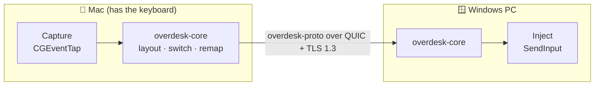

<div align="center">

# Overdesk

**One keyboard. One mouse. Every computer on your desk.**

Move your cursor off the edge of your Mac and keep working on your Windows PC,
with input that feels native on both.

[](https://github.com/fkitsantas/Overdesk/actions/workflows/ci.yml)
[](LICENSE)
[](COMMERCIAL.md)
[](rust-toolchain.toml)


> [!WARNING]
> **Pre-alpha.** The protocol and core logic exist and are tested. Nothing moves a real
> cursor yet. Star or watch the repo to follow along.

</div>

---

## Why Overdesk

Most people who share a keyboard and mouse are Mac users with a Windows PC next to
them. Existing tools treat the Mac as an afterthought. Overdesk is built around it.

| | Overdesk | Typical KVM software |
|---|---|---|
| **Magic Mouse & trackpad scrolling** | Pixel-precise deltas with gesture and momentum phases, so inertia and rubber-banding survive the trip | Converted to coarse wheel notches |
| **Apple keyboard on Windows** | <kbd>⌘</kbd>+<kbd>C</kbd> copies on Windows; <kbd>Ctrl</kbd>+<kbd>C</kbd> on a PC keyboard copies on the Mac | Manual remapping, or none |
| **Transport** | QUIC with TLS 1.3, encrypted by default | Plain TCP, TLS optional |
| **Pairing** | Certificate fingerprint, trusted on first use | Manual fingerprint files |
| **Stuck keys** | Every held key is released when focus leaves a screen or a peer drops | Common complaint |
| **Language** | Memory-safe Rust | Mostly C++ |

<sub>The Overdesk column describes the design. Items not yet built are tracked in the roadmap below.</sub>

## Roadmap

| Phase | What | Status |
|---|---|---|
| 0 | Workspace, CI on macOS / Windows / Linux, license checks, CLA | ✅ Done |
| 1 | Wire protocol and core logic: screen layout, edge switching, held keys, ⌘↔Ctrl remap | ✅ Done |
| 2 | QUIC networking, pairing, LAN discovery, latency benchmark | ⏳ Next |
| 3 | **macOS** capture and injection, plus native Magic Mouse / trackpad / keyboard (media and 🌐 Globe keys) | 🔜 |
| 4 | **Windows** capture and injection | 🔜 |
| 5 | Desktop app: Tauri 2 + Svelte 5, drag-to-arrange screens, tray icon | 🔜 |
| 6 | Linux (X11, then Wayland through libei) | 🔜 |
| 7 | Signed installers: `.dmg`, `.msi`, `.AppImage` | 🔜 |
| 8 | Android TV client | 🔭 Stretch |

## Architecture



| Crate | Role |
|---|---|
| [`overdesk-proto`](crates/overdesk-proto) | Wire messages and length-prefixed framing; rejects frames over 1 MiB |
| [`overdesk-core`](crates/overdesk-core) | Platform-free logic: layout validation, cursor handoff across screen edges, held-key tracking, ⌘↔Ctrl remap |

Positions use one logical, DPI-independent coordinate plane, so a Retina MacBook and a 4K
Windows monitor line up the way you arrange them.

## Build from source

Requires [Rust](https://rustup.rs). `rust-toolchain.toml` selects the latest stable toolchain.

```bash
git clone https://github.com/fkitsantas/Overdesk.git
cd Overdesk
cargo test --workspace
```

## Contributing

Pull requests are welcome. Before your first one is merged, the CLA bot asks you to sign the
[Contributor License Agreement](CLA.md) by leaving a single comment.

Overdesk is a clean-room project. Please don't copy code from Deskflow, Synergy, Barrier or
Input Leap.

## License

Overdesk is **dual-licensed**:

- **[AGPL-3.0-only](LICENSE)**: free for everyone. If you ship or host a modified version,
  you must publish your source under the same license.
- **[Commercial license](COMMERCIAL.md)**: for using Overdesk in closed-source or
  commercial products.

<div align="center"><sub>Made for people who own more than one computer and only want one keyboard.</sub></div>
