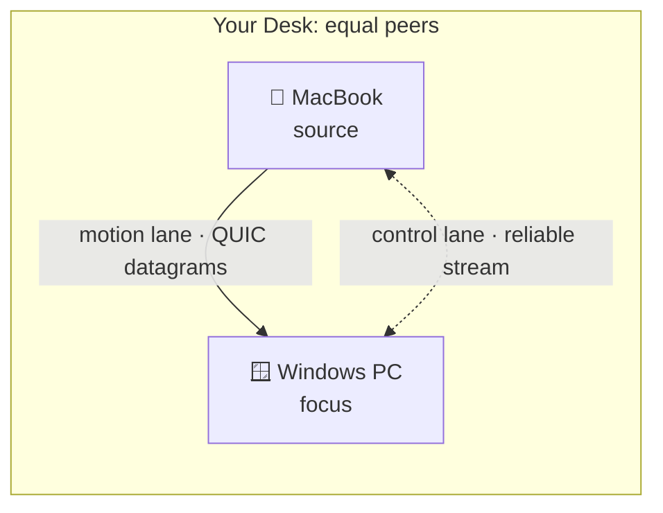

<div align="center">

# Overdesk

**One keyboard. One mouse. Every computer on your desk.**

Slide your cursor off your Mac and keep working on your Windows PC,
with input that feels native on both.

[](LICENSE)
[](COMMERCIAL.md)
[](rust-toolchain.toml)


> [!WARNING]
> **Pre-alpha.** Mac to Mac works today, hand-tested on real hardware: discovery, pairing,
> crossing screens and the native Apple feel. Windows is built but not yet tested on a real
> PC. There are no public downloads yet. Star or watch the repo to follow along.

</div>

---

## Why Overdesk

Your desk is one workspace, not a server with clients bolted on. Overdesk turns every
device on it into a single computer, and it's built for the most common desk of all:
**a Mac beside a Windows PC.**

<table>
<tr>
<td width="50%" valign="top">

### ✋ Input follows your hand
There's no server or client. Touch the Mac trackpad and it drives the PC; grab the PC
mouse and it drives the Mac. Every device is an equal peer.

</td>
<td width="50%" valign="top">

### 🍎 Apple input, native everywhere
Pixel-precise Magic Mouse and trackpad scrolling, with momentum and rubber-banding intact.
Pinch, rotate and smart zoom. <kbd>⌘</kbd>+<kbd>C</kbd> copies on Windows.

</td>
</tr>
<tr>
<td valign="top">

### ⚡ A cursor that never stalls
Pointer motion travels as QUIC datagrams where the newest wins, so a lost packet is
simply superseded. Keys travel on a separate reliable lane and never arrive out of order.

</td>
<td valign="top">

### 🔐 Private by default
Every connection is TLS 1.3. To pair, both screens show the same 6-digit code. No
fingerprint files to copy around.

</td>
</tr>
<tr>
<td valign="top">

### 🧭 One Desk, edited anywhere
Layout and settings are replicated to every device. Rearrange your screens from whichever
computer you're sitting at.

</td>
<td valign="top">

### 📋 Shared clipboard
Copy text on one computer and paste it on the other. Copies a password manager marks as
private never leave the computer. Images and files come with Pro.

</td>
</tr>
</table>

<sub>These features describe the design; the roadmap below shows what's built.</sub>

## Roadmap

| Phase | What | Status |
|---|---|---|
| 0 | Workspace, local checks on macOS / Windows / Linux (no paid CI), license checks, CLA | ✅ Done |
| 1 | Two-lane wire protocol and core logic: screen layout, edge switching, held keys, ⌘↔Ctrl remap | ✅ Done |
| 2 | **macOS** capture and injection with native Magic Mouse / trackpad / keyboard feel | ✅ Built and hand-tested ([evidence](docs/tdd/macos-adapter.tdd.md)) |
| 3 | QUIC lanes, 6-digit pairing, replicated Desk state, latency benchmark | ✅ Built and tested over loopback |
| 3b | `overdeskd` daemon: Desk engine, saved pairings, failsafe escape chord. Hand-tested on a Mac ([evidence](docs/tdd/daemon.tdd.md)) | ✅ Done |
| 3c | LAN discovery over mDNS: nearby computers appear by name, no IP addresses | ✅ Built and hand-tested |
| 4 | **Windows** capture and injection (low-level hooks, Raw Input, `SendInput`) | 🧪 Built; real-PC test pending |
| 5 | Desktop app in pure Rust (iced): Desk map, pairing, menu-bar / tray icon, light and dark | ✅ Built and hand-tested on a Mac |
| 6 | **Linux**: X11 (XInput2 capture, XTest injection) and Wayland through the desktop portals (InputCapture, RemoteDesktop), picked at run time | 🧪 Both built; X11 tested on a virtual display, Wayland unit-tested; app, tray, AppImage and .deb built. Real-desktop test pending ([docs/WAYLAND.md](docs/WAYLAND.md)) |
| 7 | Per-user installers, **signed self-updates without admin rights** (built for managed corporate laptops) with automatic rollback of an update that fails to start (macOS), device keys in Keychain / DPAPI, Overdesk Pro license keys | 🧪 Built; install-and-update test pending. Developer ID / Authenticode signing 🔜 |
| 8 | Android TV client (Pro) | 🔭 Stretch |

## Architecture



| Crate | Role |
|---|---|
| [`overdesk-proto`](crates/overdesk-proto) | Wire types for both lanes, length-prefixed control frames (1 MiB cap), wrap-safe motion sequencing |
| [`overdesk-core`](crates/overdesk-core) | Pure logic: layout validation, cursor focus across screen edges, held-key release, ⌘↔Ctrl remap |
| [`overdesk-net`](crates/overdesk-net) | QUIC transport: mutual TLS 1.3 with device certificates, control stream and motion datagrams, 6-digit commit-reveal pairing, `Hello` identity checks |
| [`overdeskd`](crates/overdeskd) | The daemon: wires capture, network and injection to the Desk engine (Local, Driving or Driven), pairing in the terminal |
| [`overdesk-platform`](crates/overdesk-platform) | OS adapters. macOS: Quartz event tap and injection with real modifier flags, drag events, double-click counts and scroll momentum phases. Windows: low-level hooks, Raw Input deltas and `SendInput` with scan codes. Linux (X11): XInput2 raw capture and XTest injection |
| [`overdesk-app`](crates/overdesk-app) | The desktop app (iced): nearby computers, pairing, the Desk map, tray icon and signed self-update |

Read the full design in **[docs/ARCHITECTURE.md](docs/ARCHITECTURE.md)**.

## Build from source

Requires [Rust](https://rustup.rs). `rust-toolchain.toml` selects the latest stable toolchain.

```bash
git clone https://github.com/fkitsantas/overdesk.git
cd Overdesk
./scripts/check.sh        # fmt, clippy, tests, licenses  (Windows: scripts\check.ps1)
```

Run the desktop app on two computers on the same network. Each one lists the other under
**Nearby**; pick it, check that both screens show the same 6-digit code, and you're sharing:

```bash
cargo run --release -p overdesk-app
```

Pair once. After that, the two computers find each other and reconnect on their own: after
a restart, sleep, or a dropped Wi-Fi. Repeated wrong pairing attempts from other computers
are slowed down (10 s, then 30 s, then 60 s). Every monitor counts: the cursor crosses from whichever
display touches the edge, and the other computer's mouse reaches all of yours. Press **Disconnect** and they stay apart until you
connect again. Installed copies open at login (per user, no admin rights); switch it off on
the pairing screen or in the tray menu.

On a Mac, try the input probe. First grant your terminal **Input Monitoring** and
**Accessibility** in System Settings › Privacy & Security:

```bash
cargo run -p overdesk-platform --example mac_probe -- listen   # prints your input for 10 s
cargo run -p overdesk-platform --example mac_probe -- inject   # draws a small square with the cursor
```

Try the daemon on one Mac, driving a headless "PC" that prints what it would inject:

```bash
cargo build -p overdeskd
# Terminal 1: the pretend PC (auto-confirms the pairing code)
yes y | OVERDESK_HOME=/tmp/od-pc  ./target/debug/overdeskd listen 127.0.0.1:24801 --headless --pair
# Terminal 2: your Mac; type y if both terminals show the same code
OVERDESK_HOME=/tmp/od-mac ./target/debug/overdeskd connect 127.0.0.1:24801 --pair --exit-after 60
```

Push the cursor off your screen's right edge to drive the PC. Move back left, or press
<kbd>⌃</kbd><kbd>⌥</kbd><kbd>⌘</kbd><kbd>⎋</kbd>, to return.

Measure motion-lane latency over loopback QUIC:

```bash
cargo run --release -p overdesk-net --example latency
# motion round trip over loopback, 2000 samples: p50 256µs  p99 804µs  lost 0   (measured on a Mac, release build)
```

## Contributing

Pull requests are welcome. Before your first one is merged, the CLA bot asks you to sign the
[Contributor License Agreement](CLA.md) by leaving a single comment.

Overdesk is a clean-room project. Please don't copy code from Deskflow, Synergy, Barrier or
Input Leap.

## Free and Pro

| | **Overdesk Free** | **Overdesk Pro** · £20 lifetime |
|---|:---:|:---:|
| Devices on one Desk | 2 | Unlimited |
| Native Magic Mouse, trackpad and keyboard feel | ✅ | ✅ |
| Encrypted peer-to-peer, text clipboard | ✅ | ✅ |
| File and image clipboard | — | ✅ |
| Trackpad gestures (pinch, rotate, smart zoom) | — | ✅ |
| Android TV | — | ✅ |

One payment, licensed to your email, for every device you own. No subscription.

## License

Overdesk is **open core**. Everything in this repository is
**[AGPL-3.0-only](LICENSE)**. Pro features are a separate, closed module. Companies that
want to embed Overdesk code in closed-source products can get a
**[commercial license](COMMERCIAL.md)**.

<div align="center"><sub>Made for people who own more than one computer and only want one keyboard.</sub></div>
