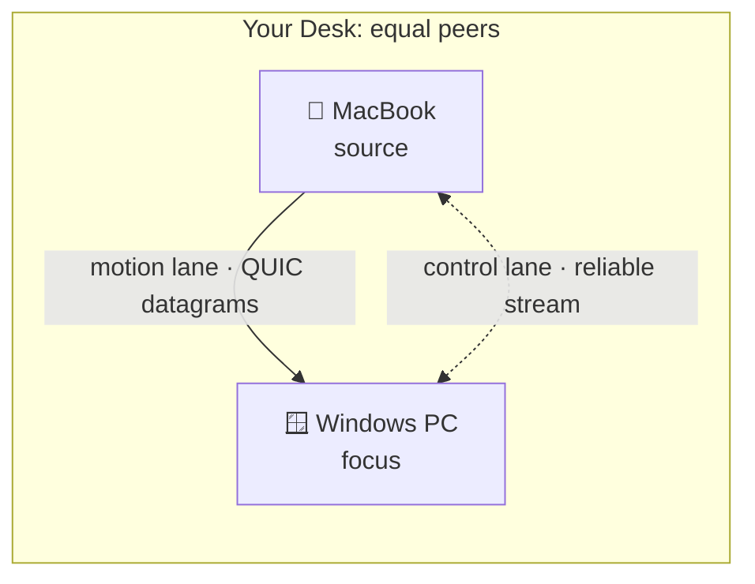

<div align="center">

# Overdesk

**One keyboard. One mouse. Every computer on your desk.**

Slide your cursor off your Mac and keep working on your Windows PC,
with input that feels native on both.

[](https://github.com/fkitsantas/Overdesk/actions/workflows/ci.yml)
[](LICENSE)
[](COMMERCIAL.md)
[](rust-toolchain.toml)


> [!WARNING]
> **Pre-alpha.** The protocol and core logic exist and are tested. Nothing moves a real
> cursor yet. Star or watch the repo to follow along.

</div>

---

## Why Overdesk

Your desk is one workspace, not a server with clients bolted on. Overdesk turns every
device on it into a single computer, and it's built for the most common desk of all:
**a Mac beside a Windows PC.**

<table>
<tr>
<td width="50%" valign="top">

### ✋ Input follows your hand
There's no server or client. Touch the Mac trackpad and it drives the PC; grab the PC
mouse and it drives the Mac. Every device is an equal peer.

</td>
<td width="50%" valign="top">

### 🍎 Apple input, native everywhere
Pixel-precise Magic Mouse and trackpad scrolling, with momentum and rubber-banding intact.
Pinch, rotate and smart zoom. <kbd>⌘</kbd>+<kbd>C</kbd> copies on Windows.

</td>
</tr>
<tr>
<td valign="top">

### ⚡ A cursor that never stalls
Pointer motion travels as QUIC datagrams where the newest wins, so a lost packet is
simply superseded. Keys travel on a separate reliable lane and never arrive out of order.

</td>
<td valign="top">

### 🔐 Private by default
Every connection is TLS 1.3. To pair, both screens show the same 6-digit code. No
fingerprint files to copy around.

</td>
</tr>
<tr>
<td valign="top">

### 🧭 One Desk, edited anywhere
Layout and settings are replicated to every device. Rearrange your screens from whichever
computer you're sitting at.

</td>
<td valign="top">

### 📋 Clipboard on demand
A copy only announces what it holds. Bytes move when you paste, so a 50 MB screenshot
costs nothing until you use it.

</td>
</tr>
</table>

<sub>These features describe the design; the roadmap below shows what's built.</sub>

## Roadmap

| Phase | What | Status |
|---|---|---|
| 0 | Workspace, CI on macOS / Windows / Linux, license checks, CLA | ✅ Done |
| 1 | Two-lane wire protocol and core logic: screen layout, edge switching, held keys, ⌘↔Ctrl remap | ✅ Done |
| 2 | Replicated Desk state, QUIC lanes, 6-digit pairing, LAN discovery, latency benchmark | ⏳ Next |
| 3 | **macOS** capture and injection, plus native Magic Mouse / trackpad / keyboard (media and 🌐 Globe keys) | 🔜 |
| 4 | **Windows** capture and injection | 🔜 |
| 5 | Desktop app: Tauri 2 + Svelte 5, drag-to-arrange screens, tray icon | 🔜 |
| 6 | Linux (X11, then Wayland through libei) | 🔜 |
| 7 | Signed installers: `.dmg`, `.msi`, `.AppImage` | 🔜 |
| 8 | Android TV client | 🔭 Stretch |

## Architecture



| Crate | Role |
|---|---|
| [`overdesk-proto`](crates/overdesk-proto) | Wire types for both lanes, length-prefixed control frames (1 MiB cap), wrap-safe motion sequencing |
| [`overdesk-core`](crates/overdesk-core) | Pure logic: layout validation, cursor focus across screen edges, held-key release, ⌘↔Ctrl remap |

Read the full design in **[docs/ARCHITECTURE.md](docs/ARCHITECTURE.md)**.

## Build from source

Requires [Rust](https://rustup.rs). `rust-toolchain.toml` selects the latest stable toolchain.

```bash
git clone https://github.com/fkitsantas/Overdesk.git
cd Overdesk
cargo test --workspace
```

## Contributing

Pull requests are welcome. Before your first one is merged, the CLA bot asks you to sign the
[Contributor License Agreement](CLA.md) by leaving a single comment.

Overdesk is a clean-room project. Please don't copy code from Deskflow, Synergy, Barrier or
Input Leap.

## License

Overdesk is **dual-licensed**:

- **[AGPL-3.0-only](LICENSE)**: free for everyone. If you ship or host a modified version,
  you must publish your source under the same license.
- **[Commercial license](COMMERCIAL.md)**: for using Overdesk in closed-source or
  commercial products.

<div align="center"><sub>Made for people who own more than one computer and only want one keyboard.</sub></div>
