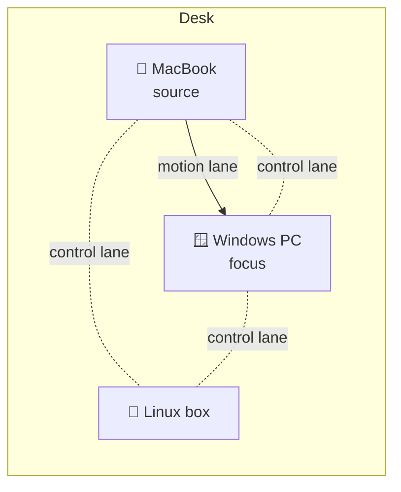
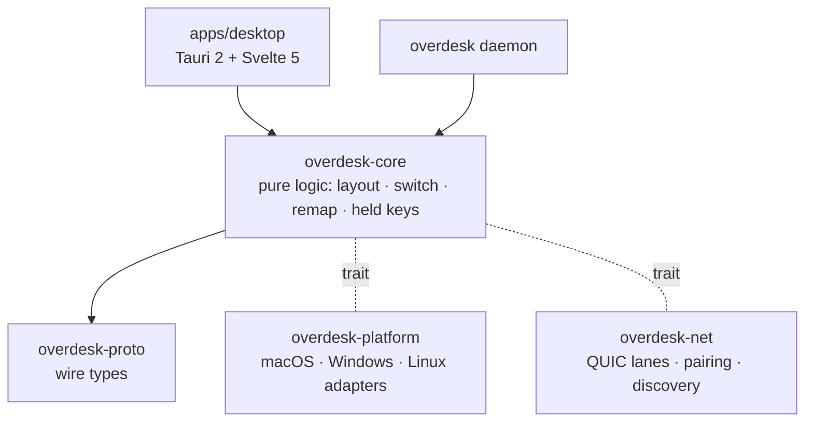

# Overdesk architecture

Overdesk is designed from first principles around one experience: **every device on your
desk feels like one computer, and Apple input feels native everywhere.**

## 1. Desk of equal peers

There is no server and no client. Every device runs the same `overdesk` daemon. Paired
devices form a **Desk**.

- **Input follows the hand.** Whichever device's physical keyboard, mouse or trackpad you
  touch becomes the *source*. The device that holds the cursor is the *focus*.
- **Arbitration: last touch wins.** After the source changes, it is held for 300 ms so that
  two people bumping two mice don't fight over the cursor.
- Every peer runs the same pure `Switcher` on the shared layout, so any peer can compute
  focus changes.

## 2. Two lanes, one QUIC connection

Each pair of peers shares one QUIC connection (TLS 1.3) with two lanes:

| Lane | QUIC primitive | Carries | Why |
|---|---|---|---|
| **Motion** | Unreliable datagrams | Absolute pointer position plus a sequence number | A lost packet is simply superseded by the next one, so the cursor never stalls. Stale or reordered datagrams are dropped by sequence number (serial-number arithmetic, wrap-safe). |
| **Control** | One reliable, ordered stream | Focus, keys, buttons, scroll, gestures, clipboard, Desk state | Order matters: a key-down must never arrive after its key-up. |

Control frames are a `u32` big-endian length followed by a [postcard](https://docs.rs/postcard)
payload. Frames over 1 MiB are refused on both sides. A motion datagram is one bare postcard
message.

## 3. Replicated Desk state

Layout, peers and settings live on **every** peer as one versioned document:

- Any device's UI can edit it. The edit bumps the version and broadcasts on the control lane.
- Peers keep the highest `(version, author)`.
- There is no master configuration file.

A received document is adopted only if:
- its `author` is the authenticated peer that sent it;
- its version moves forward by at most 2²⁰ (honest peers bump it by 1 per edit);
- it has at most 64 screens;
- every screen belongs to a peer this device has paired with;
- the layout itself is valid, with no overlaps and no zero sizes.

The document carries layout only, never trust.

## 4. Semantic input model

Events describe *intent*, not raw OS events. Each OS adapter translates to and from its native APIs.

| Event | Encoding |
|---|---|
| Keys | USB HID usage IDs. Command/Control swap between Mac and PC peers. |
| Pointer | Absolute position, in the focused screen's logical, DPI-independent coordinates |
| Scroll | Pixel or ¹⁄₁₂₀-notch deltas plus a phase (`Began`, `Changed`, `Ended`, `Momentum…`), so macOS inertia and rubber-banding survive the trip |
| Gestures | Magnify, rotate and smart zoom, with phases, delivered natively on macOS |

Apple fidelity lives in the macOS adapter. The wire format never throws that information away.

## 5. Hexagonal layering

- `core` and `proto` never touch the OS or the network. They are fully unit-tested.
- Platform and network code are adapters behind traits, each with a fake implementation for tests.

## 6. Lazy clipboard

A peer whose clipboard changes **announces** the formats it holds (text, image, files).
Bytes cross the wire only when another peer actually pastes, so copying a 50 MB image
costs nothing until it's used.

## 7. Pairing

Each device has a long-lived key pair inside a self-signed certificate. Its `PeerId` is
the first 16 bytes of the SHA-256 fingerprint of that certificate.

1. The devices connect over mutual TLS 1.3. Certificate *chains* are not checked, but the
   handshake signature always is, so a device must hold the private key of the
   certificate it presents.
2. On a connection between peers that aren't yet trusted, only the `Pairing` message
   type exists. `Control` messages never decode there, so an unpaired device cannot send
   input.
3. **Commit, then reveal:**
   - The dialer sends `Commit = SHA-256(dialer fingerprint ‖ dialer nonce)`.
   - The listener replies with its own fresh nonce.
   - The dialer reveals its nonce, and the listener checks it against the commitment.
4. Both screens show `SHA-256(both fingerprints ‖ both nonces) mod 10⁶` as a 6-digit code.

Because the dialer commits before it sees the listener's nonce, an attacker in the middle
can't keep trying keys until the codes match. It gets one chance in a million per
attempt, and every failed attempt is visible to the user.

5. Each user confirms that the codes match. The peer is pinned only after **both** sides
   confirm. Later connections are authenticated by the pinned fingerprint, with no prompt.

Trust is strictly pairwise: replicated Desk state can never add a trusted key.

### Limits against unpaired peers

Any device on the network can complete a TLS handshake with its own self-signed
certificate. Before pairing, it can only:

- open **one** stream, and send frames of at most 128 bytes;
- take up at most a few MB of buffered data;
- hold its setup for 5 s, and a pairing for 60 s, including the user's answer.

On top of that:
- Unknown source addresses must first prove they're real (QUIC Retry).
- At most 64 handshakes can be in progress at once.
- Control and motion messages are refused until the peer's fingerprint is pinned.

Planned with the daemon:
- Pairing is accepted only while the user has "Pair a device" open, and only one at a time.
- Repeated failed pairings back off.

## 8. Install once, update without admin

The goal: IT approves and installs Overdesk once, and every later update installs itself
for that user, silently, with no admin prompt. That's what makes Overdesk viable on
managed corporate laptops.

**Rules that all code follows now:**

- **Per-user only.** No Windows service, no `launchd` daemon, no root helper, no writes
  to `Program Files`, `/Library` or `HKLM`. Settings and keys live under the user's
  profile (already done: `~/Library/Application Support/Overdesk` on macOS,
  `%APPDATA%\Overdesk` on Windows).
- **Start at login per-user:** `SMAppService` login item on macOS, the `HKCU\…\Run`
  key on Windows.
- **Input access without admin:**
  - On Windows, low-level hooks and `SendInput` work as a standard user. Windows won't let
    a standard process inject into elevated (admin) windows; we document that and don't
    work around it.
  - On macOS, the Accessibility and Input Monitoring grants belong to the code signature.
    Updates signed with the same Developer ID keep the grants, so they're not prompted for again.

**Install locations (user-writable, so the app can replace itself):**

| OS | Installer | Location |
|---|---|---|
| Windows | Per-user NSIS installer (Tauri `installMode: currentUser`) | `%LOCALAPPDATA%\Programs\Overdesk` |
| macOS | `.pkg` with "Install for me only" (`enable_currentUserHome`) | `~/Applications/Overdesk.app` |

**Update flow** (Tauri 2 updater plugin):
1. Check `https://overdesk.org/updates/{os}/{arch}/{channel}.json` over HTTPS.
2. Download the new bundle. Verify its **Ed25519 signature** against the public key built
   into the app, and reject it if verification fails. The private key never leaves the
   release machine.
3. Replace the app in its per-user location, then restart: at the next idle moment, never
   while you're driving another device.
4. Keep the previous version, and roll back automatically if the new one fails to start.

**For IT departments:**
- **Code signing:** Authenticode on Windows, Developer ID with notarization on macOS. IT
  can then allow-list Overdesk *by publisher* (AppLocker or WDAC publisher rules, Jamf or
  Intune), so updates in a per-user folder still pass.
- **A policy to pin or turn off updates**, and a choice of `stable` / `beta` channel.
  The policy comes from a managed config: macOS configuration profile, Windows `HKCU`/`HKLM`
  policy key.

**Costs to plan for:**
- Apple Developer Program: about £79 a year.
- A Windows code-signing certificate: about £200–400 a year.

## Status

| Part | State |
|---|---|
| Wire types: control and motion lanes, `PeerId`, focus, gestures | ✅ |
| Wrap-safe sequence filter for motion | ✅ |
| `Switcher`, held keys, ⌘↔Ctrl remap | ✅ |
| Replicated Desk state (merge and validation) | ✅ |
| Lazy clipboard (the wire has plain text for now) | 🔜 |
| Pairing exchange (commit-reveal, 6-digit code) | ✅ |
| QUIC lanes: mutual TLS 1.3, control stream, motion datagrams | ✅ |
| Saving device keys to disk, daemon | ✅ |
| LAN discovery (mDNS) | 🔜 |
| Per-user installers and signed self-update (§8) | 🔜 |
| Platform adapters | 🔜 |
