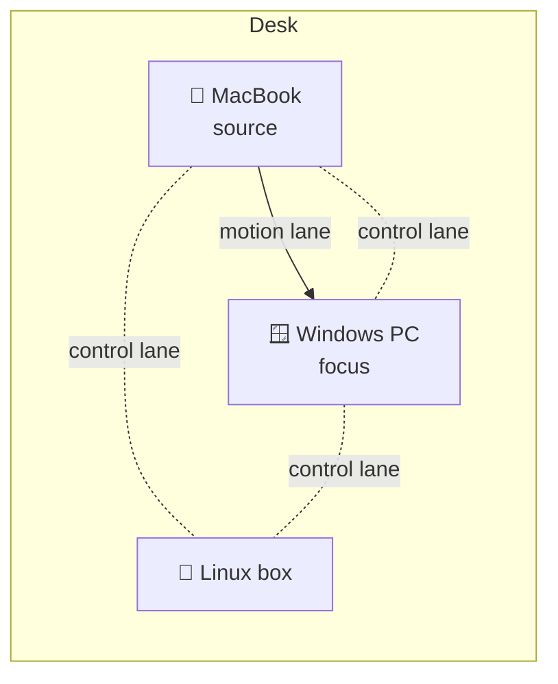
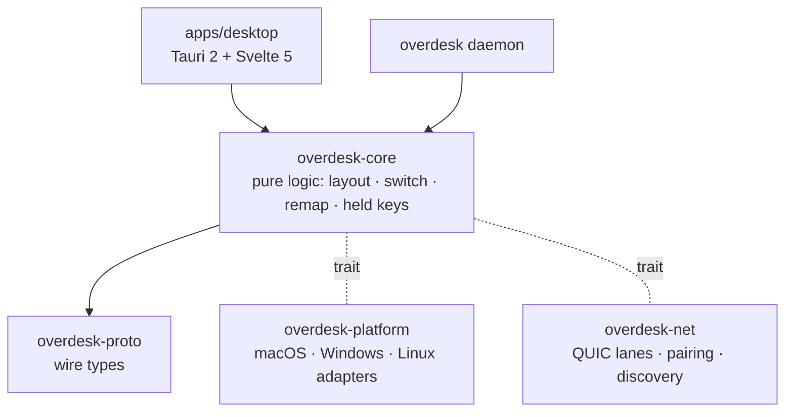

# Overdesk architecture

Overdesk is designed from first principles around one experience: **every device on your
desk feels like one computer, and Apple input feels native everywhere.**

## 1. Desk of equal peers

There is no server and no client. Every device runs the same `overdesk` daemon. Paired
devices form a **Desk**.

- **Input follows the hand.** Whichever device's physical keyboard, mouse or trackpad you
  touch becomes the *source*. The device that holds the cursor is the *focus*.
- **Arbitration: last touch wins.** After the source changes, it is held for 300 ms so that
  two people bumping two mice don't fight over the cursor.
- Every peer runs the same pure `Switcher` on the shared layout, so any peer can compute
  focus changes.

## 2. Two lanes, one QUIC connection

Each pair of peers shares one QUIC connection (TLS 1.3) with two lanes:

| Lane | QUIC primitive | Carries | Why |
|---|---|---|---|
| **Motion** | Unreliable datagrams | Absolute pointer position plus a sequence number | A lost packet is simply superseded by the next one, so the cursor never stalls. Stale or reordered datagrams are dropped by sequence number (serial-number arithmetic, wrap-safe). |
| **Control** | One reliable, ordered stream | Focus, keys, buttons, scroll, gestures, clipboard, Desk state | Order matters: a key-down must never arrive after its key-up. |

Control frames are a `u32` big-endian length followed by a [postcard](https://docs.rs/postcard)
payload. Frames over 1 MiB are refused on both sides. A motion datagram is one bare postcard
message.

## 3. Replicated Desk state

Layout, peers and settings live on **every** peer as one versioned document:

- Any device's UI can edit it. The edit bumps the version and broadcasts on the control lane.
- Peers keep the highest version; ties are broken by `PeerId`.
- There is no master configuration file.

## 4. Semantic input model

Events describe *intent*, not raw OS events. Each OS adapter translates to and from its native APIs.

| Event | Encoding |
|---|---|
| Keys | USB HID usage IDs. Command/Control swap between Mac and PC peers. |
| Pointer | Absolute position, in the focused screen's logical, DPI-independent coordinates |
| Scroll | Pixel or ¹⁄₁₂₀-notch deltas plus a phase (`Began`, `Changed`, `Ended`, `Momentum…`), so macOS inertia and rubber-banding survive the trip |
| Gestures | Magnify, rotate and smart zoom, with phases, delivered natively on macOS |

Apple fidelity lives in the macOS adapter. The wire format never throws that information away.

## 5. Hexagonal layering

- `core` and `proto` never touch the OS or the network. They are fully unit-tested.
- Platform and network code are adapters behind traits, each with a fake implementation for tests.

## 6. Lazy clipboard

A peer whose clipboard changes **announces** the formats it holds (text, image, files).
Bytes cross the wire only when another peer actually pastes, so copying a 50 MB image
costs nothing until it's used.

## 7. Pairing

- Each device has a long-lived key pair; its `PeerId` derives from the public key.
- To pair, both screens show the same 6-digit code, and the user confirms on both.
- Paired keys are pinned, so later connections are mutually authenticated with no prompt.

## Status

| Part | State |
|---|---|
| Wire types: control and motion lanes, `PeerId`, focus, gestures | ✅ |
| Wrap-safe sequence filter for motion | ✅ |
| `Switcher`, held keys, ⌘↔Ctrl remap | ✅ |
| Replicated Desk state | 🔜 |
| Lazy clipboard (the wire has plain text for now) | 🔜 |
| QUIC lanes and pairing | 🔜 |
| Platform adapters | 🔜 |
